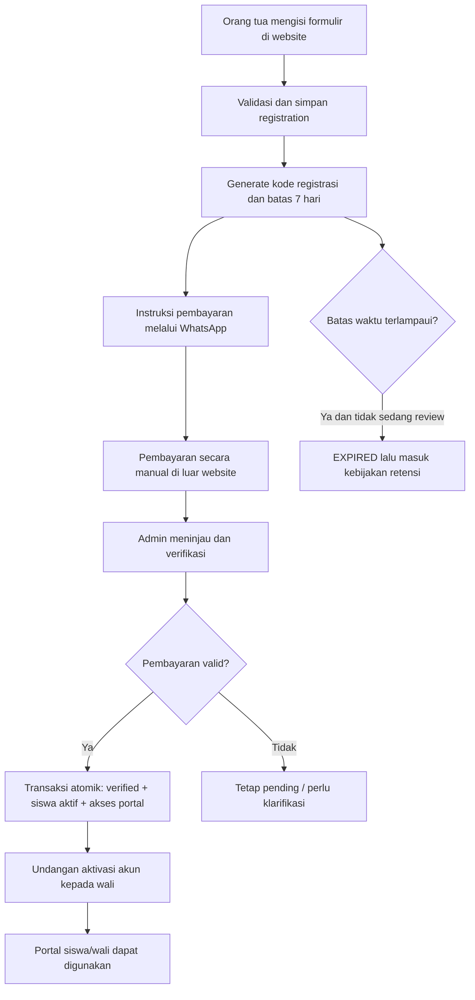
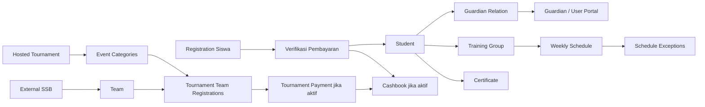

# TIMORE SOCCER SCHOOL — ADMIN DASHBOARD & INTEGRATED OPERATIONS SPECIFICATION

> **Dokumen:** Product requirements + functional specification + engineering handoff  
> **Proyek:** Pengembangan Website Profil dan Informasi Timore Soccer School sebagai Media Promosi dan Pendaftaran  
> **Tim:** Kelompok 100/100 — Proyek Teknologi Informasi, Telkom University  
> **Versi:** 1.0 — 23 November 2026  
> **Fokus:** Dashboard admin, integrasi website publik, dan portal siswa/wali  
> **Status:** **DRAFT USULAN**. Bagian bertanda `[CONFIRM MITRA]` belum menjadi komitmen implementasi.  
> **Tanpa payment gateway.** Pembayaran diselesaikan di luar website dan dikonfirmasi admin secara manual.  
> **Tujuan pembaca:** PM, UI/UX, frontend, backend, QA, dan pengelola Timore Soccer School.

---

## 0. CARA MEMBACA DOKUMEN DAN BATAS KEPUTUSAN

### 0.1 Makna label

| Label | Makna | Perlakuan |
|---|---|---|
| `BASELINE` | Kebutuhan yang memang tercantum dalam dokumen proyek awal | Pertahankan dalam cakupan proyek |
| `AGREED-DISCUSSION` | Arah fitur dari diskusi terbaru tim sebagaimana disampaikan pemilik permintaan | Jadikan basis rancangan revisi, lalu validasi dalam change approval mitra/PM |
| `RECOMMENDED` | Rancangan yang disarankan untuk mengefisienkan administrasi dan backend | Implementasi setelah prioritas/biaya/waktu disetujui |
| `PENDING` | Sengaja belum diputuskan | Jangan mengarang aturan final atau memaksakan workflow |
| `OUT` | Tidak dibangun pada scope ini | Jangan membuat fitur terkait tanpa persetujuan perubahan |

**Aturan prioritas:** diskusi terbaru menegaskan *jadwal rutin dengan pengecualian*, *turnamen diselenggarakan TSS dan didaftari tim/sekolah lain*, serta *penilaian/indikator belum diputuskan*. Ketiganya mengoreksi interpretasi konsep sebelumnya. Tidak ada fitur LMS, payment gateway, aplikasi mobile native, live score, atau otomatisasi seluruh operasional sekolah.

### 0.2 Dokumen rujukan

1. `NeedStatement_100_100_WebsiteProfileTimore.docx` — masalah informasi tersebar di Instagram/TikTok/WhatsApp, kebutuhan website terpusat, pendaftaran.
2. `Project_Charter_Timore_Soccer_School.docx` — cakupan awal profil, jadwal, coach, prestasi, event, pendaftaran, admin; pengecualian sistem pembayaran online, administrasi keanggotaan kompleks, notifikasi eksternal belum disepakati.
3. `ProjectCharter_100_100_WebsiteProfileTimore.docx` — charter rinci, tim dan anggaran/domain-hosting.
4. `ProjectManagementPlan_100_100_WebsiteProfileTimore.docx` — WBS, project constraints, QA, rencana pengujian, serah terima.
5. `SRS_100_100_WebsiteProfileTimore.docx` — rincian modul profil, coach/pengurus, kelompok usia, jadwal, event, berita, pendaftaran, kontak, dashboard; usulan Laravel + Bootstrap, shared hosting.

**Catatan konflik sumber:** dokumen awal menyatakan pembayaran online, iuran kompleks dan manajemen turnamen khusus di luar scope. Fitur verifikasi pembayaran manual, pembukuan/iuran ringan, dan **pendaftaran tim turnamen** pada file ini merupakan **perluasan scope hasil diskusi**, bukan fitur yang telah disetujui pada charter asli. Perubahan ini wajib direkonsiliasi pada SRS/charter serta dibicarakan bersama mitra dan dosen sebelum dinyatakan final. Modul penilaian dan sertifikat juga merupakan tambahan.

### 0.3 Sasaran desain

- Admin mendapat satu tempat untuk mengurus pendaftaran, pembayaran manual, akun, siswa, jadwal rutin, event/turnamen, konten publik, sertifikat, keuangan ringan dan laporan.
- Sebisa mungkin **sekali input, dipakai beberapa modul**. Hindari mencatat nominal pembayaran atau jadwal yang sama dua kali.
- Dashboard memprioritaskan pekerjaan nyata: data perlu dicek, event perlu diproses, jadwal berubah, dokumen perlu diterbitkan.
- Backend tidak hanya CRUD: state machine, transaksi idempoten, deteksi duplikasi, sinkronisasi jadwal, pemrosesan periodik, validasi peserta tim, nomor dokumen, audit log, dan laporan.
- Tidak membebani pengurus dengan input rutin yang sebelumnya tidak mereka lakukan. Modul opsional boleh dinonaktifkan.
- Data pribadi anak dan wali hanya terlihat oleh pengguna berwenang; dashboard publik tidak membocorkan informasi pribadi.

---

## 1. VISI PRODUK DAN PEMBAGIAN SISTEM

### 1.1 Tiga permukaan sistem

| Surface | Pengguna | Fungsi |
|---|---|---|
| **Public Website** | Masyarakat, calon orang tua/wali, SSB lain | Profil TSS, coach, jadwal yang dapat dipublikasikan, event/turnamen, berita, prestasi, galeri, pendaftaran siswa, pendaftaran tim turnamen (bila dibuka), kontak |
| **Admin Dashboard** | Admin TSS dengan izin yang sesuai | Seluruh pengelolaan operasional dan CMS; verifikasi, data siswa, perubahan jadwal, peserta turnamen, kas, laporan, sertifikat, log |
| **Student/Guardian Portal** | Siswa/wali pemilik akun aktif | Profil sendiri, jadwal kelompoknya, event yang relevan, penilaian/perkembangan **apabila kelak disetujui dan dipublikasikan**, sertifikat yang sah |

**Tidak ada portal sekolah bola peserta turnamen penuh pada MVP.** Pendaftaran tim dari sekolah lain dapat menggunakan form publik, kode registrasi dan tautan/status yang aman. Akun pihak ketiga baru diperlukan jika mitra meminta pengelolaan berulang.

### 1.2 Kategori data

- **Master data:** siswa, wali, kategori usia, coach, lapangan, sekolah/tim peserta turnamen, kategori/aturan biaya yang disetujui.
- **Operasional:** registrasi siswa, konfirmasi pembayaran, keanggotaan, jadwal rutin, pengecualian jadwal, event, pendaftaran tim, transaksi kas.
- **Akademik olahraga (PENDING):** periode evaluasi, indikator, skor/narasi, progres siswa.
- **Dokumen:** sertifikat dan nomor verifikasinya, dokumen registrasi privat, bukti bayar jika diperlukan, bukti transaksi.
- **Konten:** beranda, tentang sekolah, coach, prestasi, berita, galeri, kontak/lokasi.
- **Sistem:** roles/permissions, status, audit log, notifikasi, background jobs.

### 1.3 Prinsip sumber data tunggal

- Jadwal publik dan portal siswa **membaca data yang sama** dari master jadwal rutin + pengecualian.
- Profil coach publik membaca master coach yang sama dari admin.
- Siswa aktif berasal dari registrasi yang telah disetujui **atau impor data lama yang disahkan admin**.
- Pembayaran yang dikonfirmasi sekali mengubah registrasi **dan** memicu pencatatan penerimaan kas (jika modul kas aktif).
- Turnamen yang dipublikasikan berasal dari modul penyelenggaraan event; peserta tim dicatat pada `tournament_registrations`, **bukan** `student_event_registrations`.
- Nilai siswa hanya dapat dilihat siswa/wali jika modul penilaian kelak diaktifkan, indikator disetujui, dan nilai berstatus **PUBLISHED**.

---

## 2. INFORMATION ARCHITECTURE / SIDEBAR ADMIN

```text
ADMIN DASHBOARD
├── 01. Overview
│   ├── Ringkasan operasional
│   ├── Action Center / Tugas perlu tindakan
│   └── Aktivitas terbaru
├── 02. Pendaftaran Siswa
│   ├── Semua pendaftaran
│   ├── Menunggu pembayaran
│   ├── Verifikasi pembayaran
│   ├── Kedaluwarsa / arsip
│   └── Riwayat status dan tindak lanjut
├── 03. Siswa & Akun
│   ├── Direktori siswa
│   ├── Detail siswa (Student 360°)
│   ├── Wali / kontak
│   ├── Kategori usia / kelompok
│   └── Akses portal siswa/wali
├── 04. Jadwal Latihan
│   ├── Jadwal rutin mingguan
│   ├── Pengecualian: tunda / ubah / batal / pengganti
│   ├── Kalender tampilan aktual
│   └── Riwayat perubahan jadwal
├── 05. Event & Turnamen
│   ├── Semua event TSS
│   ├── Turnamen yang diselenggarakan TSS
│   ├── Pendaftaran tim/sekolah peserta
│   ├── Verifikasi / daftar tim diterima / daftar tunggu
│   ├── Informasi hasil & dokumentasi (tanpa live scoring)
│   └── Event non-turnamen / publikasi kegiatan
├── 06. Penilaian & Perkembangan
│   └── PLACEHOLDER — PENDING DISKUSI MITRA (tidak ada input nilai final)
├── 07. Sertifikat
│   ├── Template sertifikat
│   ├── Kelayakan / penetapan selesai program
│   ├── Draft dan penerbitan
│   └── Verifikasi / pembatalan sertifikat
├── 08. Keuangan Ringan (jika disepakati)
│   ├── Buku kas
│   ├── Pembayaran pendaftaran
│   ├── Iuran bulanan (jika ada)
│   ├── Pengeluaran dan bukti
│   └── Rekap bulanan
├── 09. Konten Website (CMS)
│   ├── Landing page
│   ├── Profil SSB
│   ├── Pelatih & pengurus
│   ├── Berita & publikasi
│   ├── Prestasi
│   ├── Galeri / media
│   └── Kontak & lokasi
├── 10. Laporan & Ekspor
│   ├── Laporan pendaftaran / siswa
│   ├── Jadwal & perubahan
│   ├── Pendaftaran tim turnamen
│   ├── Keuangan (jika aktif)
│   ├── Sertifikat
│   └── Ekspor CSV/XLSX/PDF
└── 11. Pengaturan & Audit
    ├── Identitas sekolah
    ├── Metode & instruksi pembayaran manual
    ├── Pengaturan masa berlaku registrasi
    ├── Akun admin / permission
    ├── Integrasi WhatsApp
    ├── Pengaturan kategori / lapangan
    └── Log aktivitas
```

**UX:** submenu cukup menjadi tabs dalam satu halaman jika tugasnya berkaitan. Sebagai contoh, `Event > Detail Event` berisi tabs Informasi, Pendaftar Tim, Tim Diterima, Hasil, Galeri; tidak harus lima route UI berbeda.

### 2.1 Matriks CRUD singkat

| Entitas | Create | Read | Update | Delete/Archive | Publish/Approve | Catatan |
|---|---|---|---|---|---|---|
| Pendaftaran siswa | Public + admin | Admin | Admin terbatas | Arsip / expire | Verifikasi pembayaran | Bukan hapus fisik segera |
| Siswa & wali | Dari onboarding, impor, admin | Admin/owner | Admin/owner terbatas | Nonaktif/arsip | Aktivasi | Perubahan identitas tercatat |
| Akun | Sistem/admin | Owner/admin | Akses/credential | Suspend | Aktivasi/reset | Password tidak dapat dilihat admin |
| Jadwal rutin | Admin | Semua jika published | Admin | Nonaktifkan | Publish | Jangan ubah histori sesi |
| Pengecualian jadwal | Admin | Semua yang berkaitan | Admin | Batalkan entri dengan audit | Publish | Berlaku per tanggal tertentu |
| Turnamen/event | Admin | Publik jika publish | Admin | Archive | Publish/close | Hati-hati bila sudah ada pendaftar |
| Pendaftaran tim | Form publik/admin | Admin + pendaftar terotorisasi | Pendaftar/admin selama masa edit | Withdraw/arsip | Accept/reject | Bukan pendaftaran individual |
| Pelatih/pengurus | Admin | Publik jika publish | Admin | Arsip | Publish | Foto/biografi dari mitra |
| Berita/prestasi/galeri | Admin | Publik jika publish | Admin | Arsip | Publish | Draft/Published |
| Pembayaran | Admin | Admin/owner terbatas | Koreksi dengan alasan | VOID, bukan delete | Verify | Rekonsiliasi dengan kas |
| Transaksi kas | Sistem/admin | Admin keuangan | Koreksi tertelusur | Void/reversal | Post | Audit immutable-ish |
| Penilaian | **PENDING** | Admin; siswa hanya published kelak | **PENDING** | **PENDING** | **PENDING** | Jangan buat indikator fiktif |
| Sertifikat | Admin/sistem | Admin/owner | Draft saja | Revoke/arsip | Issue | Nomor unik dan audit |

---

## 3. OVERVIEW DASHBOARD DAN ACTION CENTER

### 3.1 Halaman awal admin

**Header:** nama sekolah; identitas admin; jam/tanggal; pengaturan akun; indikator notifikasi (jika ada).  
**Kartu ringkasan:** siswa aktif, pendaftaran belum selesai, pembayaran menunggu verifikasi, turnamen aktif/mendatang. Ringkasan **bukan** fitur kecerdasan utama.  
**Panel tugas:** pekerjaan mendesak dengan alasan dan tombol aksi langsung.  
**Kalender mini:** jadwal latihan aktual (sesudah pengecualian), turnamen/event mendatang.  
**Aktivitas terakhir:** pendaftaran masuk, verifikasi, jadwal diganti, konten terbit, sertifikat terbit.  
**Analitik:** tren pendaftaran, kapasitas/kelompok, rekap status pembayaran, kas bila aktif — hanya berdasarkan data riil.

### 3.2 Action Center berbasis kondisi data

| Rule ID | Pemicu | Isi tindakan | Tombol tindakan | Penutupan |
|---|---|---|---|---|
| AC-01 | Registrasi mendekati 7 hari dan tetap pending | Tindak lanjuti pendaftaran | Lihat / perpanjang | Hilang bila active/expired/ditutup |
| AC-02 | Bukti/konfirmasi bayar dikirim namun belum diverifikasi | Periksa pembayaran | Buka verifikasi | Selesai setelah verify/reject |
| AC-03 | Potensi data siswa duplikat | Tinjau pendaftaran mirip | Bandingkan | Admin tandai same/different |
| AC-04 | Jadwal hari tertentu diubah/dibatalkan | Pastikan info jadwal publik benar | Lihat perubahan | Hilang setelah publish |
| AC-05 | Pendaftar tim turnamen menunggu keputusan | Verifikasi tim | Buka peserta | Hilang saat approve/reject |
| AC-06 | Turnamen mencapai/menjelang deadline | Tinjau pendaftaran dan kuota | Buka event | Hilang jika ditutup |
| AC-07 | Sertifikat draft menunggu penerbitan | Tinjau sertifikat | Pratinjau | Hilang setelah issue/cancel |
| AC-08 | Iuran belum lunas (modul aktif) | Tinjau tagihan jatuh tempo | Buka iuran | Hilang ketika lunas/waive |

**Implementation:** rekomendasi dihitung oleh backend menggunakan rule IDs dan `source_type + source_id`; buat fingerprint agar satu masalah tidak menghasilkan 20 notifikasi duplikat. Prioritaskan *needs_action* dibanding jumlah total. Jangan kirim pesan WhatsApp berulang otomatis tanpa persetujuan.

### 3.3 Skoring prioritas yang transparan (RECOMMENDED)

Contoh skor `priority = urgency(0..40) + impact(0..40) + age(0..20)`. Aturan dan bobot **usulan teknis**, bukan penilaian risiko empiris. Tampilkan juga alasan: “Tenggat besok”, “Pembayaran sudah dikonfirmasi wali, belum diperiksa”, “Kapasitas event hampir penuh”. Admin dapat `resolve`, `dismiss with reason`, atau `snooze` untuk item yang boleh ditunda. Catat actor/time/reason.

### 3.4 Acceptance criteria

- Memilih kartu/action menuju daftar terfilter yang tepat.
- Hanya data sesuai hak akses yang terlihat.
- Item otomatis di-update ketika status sumber berubah.
- Action tidak duplikat untuk kasus yang sama.
- Error backend tidak membuat angka dashboard terlihat sebagai nol; tampilkan *data unavailable*.

---

## 4. MODUL PENDAFTARAN SISWA & VERIFIKASI PEMBAYARAN MANUAL

**Label:** `BASELINE` pendaftaran; `AGREED-DISCUSSION` WhatsApp, verifikasi manual, aktivasi setelah pembayaran dan masa 7 hari.

### 4.1 Alur bisnis end-to-end



**Perbedaan akun dan registrasi:** setelah submit buat `registration` dan *reservation/pending identity*; **tidak wajib membuat kredensial login aktif saat itu**. Jika tim ingin baris `users` langsung dibuat, status harus `disabled/unverified` sampai admin menyetujui. Undangan aktivasi lebih aman daripada admin mengetahui password siswa.

### 4.2 Form pendaftaran publik (baseline + penyesuaian)

| Field | Tipe | Ketentuan |
|---|---|---|
| Nama lengkap calon siswa | Text | Wajib |
| Tanggal lahir | Date | Wajib; kategori usia **diusulkan** otomatis sesuai cutoff resmi `[CONFIRM MITRA]` |
| Alamat | Text | Wajib jika sesuai SRS |
| Nama wali/orang tua | Text | Wajib |
| Nomor WhatsApp wali | Phone | Wajib; normalisasi `+62`, nomor bukan unik per siswa |
| Email wali | Email | Opsional/required `[CONFIRM MITRA]`; jangan memaksa jika tidak digunakan |
| Kategori usia | Select/suggest | Default U-8/U-10/U-12/U-14/U-16/U-18 dari SRS; cutoff dikonfirmasi |
| Berkas pendukung | File | Jika dibutuhkan mitra; maks. 2MB dari SRS, private storage |
| Persetujuan pemrosesan data | Checkbox | Teks persetujuan yang benar dan mudah dibaca |
| Catatan lain | Textarea | Opsional |

**Jangan meminta dokumen sensitif yang tidak diperlukan.** Usahakan tidak membutuhkan nomor identitas nasional, akta kelahiran, atau foto anak tanpa alasan jelas dari mitra.

### 4.3 Status dan transisi

| Status | Makna | Transisi yang diizinkan |
|---|---|---|
| `PENDING_PAYMENT` | Registrasi lengkap, pembayaran belum dikonfirmasi | `PAYMENT_REVIEW`, `ACTIVE`, `EXPIRED`, `REJECTED` |
| `PAYMENT_REVIEW` | Wali mengirim info pembayaran, admin harus memeriksa | `ACTIVE`, `PENDING_PAYMENT`, `REJECTED`; **tidak auto-expire** |
| `ACTIVE` | Pembayaran dan data dikonfirmasi, siswa aktif | `SUSPENDED`, `INACTIVE` |
| `EXPIRED` | Deadline terlampaui sebelum terverifikasi | `PENDING_PAYMENT` via restore/perpanjang atau arsip |
| `REJECTED` | Ditolak dengan alasan | Arsip / buka ulang dengan izin |
| `SUSPENDED` | Akses/keanggotaan ditangguhkan | `ACTIVE`, `INACTIVE` |
| `INACTIVE` | Berhenti/lulus/nonaktif | `ACTIVE` jika berhak kembali |

**Penting:** status `ACTIVE` adalah status keanggotaan; autentikasi akun dapat terpisah `INVITED`, `ENABLED`, `DISABLED`. Pembayaran tidak boleh otomatis menerima pendaftar yang memiliki isu administrasi yang belum diputuskan; jika perlu buat `APPROVED_PENDING_PAYMENT` sebagai status tambahan setelah kebijakan persetujuan dikonfirmasi.

### 4.4 Admin UI: Daftar pendaftaran

- Tabs: Semua, Menunggu Pembayaran, Perlu Verifikasi, Aktif, Kedaluwarsa, Ditolak.
- Kolom: kode registrasi, nama calon siswa, kategori, nama wali, WhatsApp wali, tanggal daftar, deadline, status, aksi.
- Pencarian: nama siswa, kode, nomor wali (partial), periode, kategori.
- Bulk action aman: ekspor data terbatas, tandai tindak lanjut. **Jangan bulk approve pembayaran tanpa bukti**.
- Detail: biodata, lampiran privat, histori komunikasi manual, metode pembayaran yang dipilih, bukti yang dilampirkan (opsional), action log.
- Tombol: `Hubungi via WA`, `Periksa pembayaran`, `Konfirmasi`, `Tolak`, `Perpanjang deadline`, `Tandai perlu klarifikasi`, `Arsipkan`.

### 4.5 Manual payment + WhatsApp

- SSB menentukan metode: misalnya transfer rekening atau tunai. **Nomor rekening, biaya, nama pemilik rekening, lokasi/titik bayar tidak boleh di-hardcode tanpa input resmi.**
- Tahap awal **tanpa payment gateway**, sehingga tidak dapat otomatis memastikan dana benar-benar masuk. Tombol “Sudah bayar” dari wali hanya *claim*, bukan bukti pembayaran yang valid.
- Opsi A — **Click-to-Chat**: setelah daftar tampil tombol yang membuka WhatsApp dengan pesan prefilled berisi kode registrasi dan pertanyaan metode pembayaran; pengiriman tetap dilakukan pengguna.
- Opsi B — **bot outbound via provider resmi/terintegrasi**: kirim pesan otomatis setelah submit (memerlukan akun/infrastruktur/biaya/opt-in yang disepakati). **Jangan menjanjikan pengiriman 100% otomatis jika belum ada integrasi aktif.**
- Gunakan tautan `wa.me` hanya jika nomor resmi mitra sudah dikonfirmasi. Jangan memasukkan kredensial atau data dokumen pribadi ke pesan.
- Admin mengisi `payment_method`, `paid_amount`, `paid_at`, `verified_at`, `verified_by`, optional `reference`, optional `evidence_path` saat memverifikasi.
- Verifikasi wajib log audit; `verify()` harus **idempotent** — pengulangan request tidak menggandakan siswa, akun, atau pemasukan.
- Jika kas aktif, buat `cash_transactions` unik berdasarkan `source_type=registration_payment` dan `source_id`.
- Jika verifikasi salah, lakukan **reversal/correction** dengan alasan, bukan delete transaksi diam-diam.

### 4.6 Expiry dan cleanup 7 hari

- `expires_at = submitted_at + 7 hari` sebagai **usulan default hasil diskusi**, aturan zona waktu `Asia/Jayapura` untuk operasi di Maluku Utara; simpan timestamp UTC dan tampilkan sesuai zona lokasi SSB.
- Scheduler periodik mencari registrasi `PENDING_PAYMENT` melewati batas; tandai `EXPIRED`.
- Jangan expired pembayaran `PAYMENT_REVIEW` yang masih menunggu admin.
- Jangan menghapus bukti/transaksi yang sedang disengketakan, atau data aktif.
- Registrasi expired **diarsipkan dulu**. Hard delete/anonymization hanya setelah kebijakan retensi disetujui dan tidak ada legal/operasional hold. **7 hari bukan izin otomatis menghapus seluruh data pribadi tanpa pertimbangan.**
- Admin dapat restore dan memperpanjang satu kali atau lebih sesuai izin; setiap perubahan wajib tercatat.

### 4.7 Deteksi duplikasi (RECOMMENDED)

Gunakan normalisasi nama dan nomor wali, lalu bandingkan kombinasi nama anak + tanggal lahir + wali. `fuzzy name` hanya menghasilkan flag *possible duplicate*; **nomor wali yang sama bukan bukti duplikat** karena orang tua dapat mendaftarkan beberapa anak. Admin dapat menandai `SAME_PERSON`, `SIBLING`, `NOT_DUPLICATE`. Tidak ada penggabungan otomatis yang merusak data.

### 4.8 Acceptance criteria

- Submit valid menghasilkan **satu** registration dan kode unik; invalid tidak tersimpan.
- Calon siswa tidak dapat login sebelum akses aktif.
- Setelah verifikasi yang sah, siswa/wali dapat mengaktifkan akun dan melihat data miliknya saja.
- Konfirmasi ganda tidak menciptakan dua akun dan dua transaksi kas.
- Menunggu review tidak dibersihkan oleh job 7 hari.
- Admin dapat melihat alasan/status terakhir serta riwayat waktu perubahan.
- Gagal WhatsApp tidak menghilangkan data pendaftaran; tampilkan fallback instruksi kontak manual.

---

## 5. MODUL DATA SISWA, WALI, DAN AKSES PORTAL

### 5.1 Direktori siswa

Kolom: student ID unik, nama, foto opsional, tanggal lahir, kategori usia, kelompok latihan, wali utama, nomor kontak wali (mask sesuai izin), tanggal bergabung, status, aksi. Filter kategori, status, angkatan/tahun bergabung, nama. Import data lama opsional dengan validasi dan preview; jangan menggandakan siswa yang sudah ada.

**Perbedaan konsep:** `student` adalah anak peserta latihan, `guardian` adalah orang tua/wali, `user` adalah identitas login. Seorang wali **bisa memiliki lebih dari satu siswa**; satu siswa bisa terkait lebih dari satu wali bila mitra membutuhkan. Default MVP: satu akun wali utama dengan relasi ke satu/lebih anak, atau satu akun siswa yang dikendalikan wali — **pilih salah satu setelah diskusi mitra**.

### 5.2 Student 360° Profile

Tabs:

1. **Biodata** — identitas siswa, wali, kategori usia, tanggal bergabung, status.
2. **Keanggotaan** — tanggal aktif/nonaktif, status, histori perubahan kategori.
3. **Jadwal** — jadwal rutin **beserta pengecualian efektif** sesuai kelompok.
4. **Event** — kegiatan internal yang berkaitan dengan siswa jika ada; **bukan pendaftaran tim turnamen milik SSB lain**.
5. **Evaluasi / Progress** — placeholder sampai model penilaian disepakati.
6. **Sertifikat** — status draft/terbit, file yang dapat diakses sesuai permission.
7. **Pembayaran / Iuran** — pembayaran sendiri, jika modul aktif dan visibilitas disetujui.
8. **Riwayat perubahan** — tindakan admin penting; hanya untuk admin.

Actions: edit biodata, ubah kategori (mengikuti cutoff dan kebijakan), pindah kelompok, suspend/reactivate, kirim aktivasi/reset akun, arsip. Aksi sensitif butuh konfirmasi dan audit.

### 5.3 Kategori dan pengelompokan

Dokumen SRS menyebut **U-8, U-10, U-12, U-14, U-16, U-18**. Sistem boleh membantu menyarankan kategori berdasarkan tanggal lahir, tetapi definisi cut-off usia per kompetisi/SSB **belum ditetapkan**. Jadi:

- `age_groups` configurable: nama, deskripsi, min/max usia jika disepakati, status.
- Admin dapat override kategori dengan alasan.
- Kelompok latihan boleh berbeda dari kategori usia bila mitra memerlukannya.
- Jangan secara diam-diam memindahkan semua anak kategori setiap ulang tahun; gunakan tanggal evaluasi/perpindahan yang ditetapkan SSB.

### 5.4 Portal siswa/wali

Minimal: profil, kontak wali (editable terbatas), jadwal aktual, pengumuman jadwal terkait, daftar sertifikat sah. Tabs **Progress & Evaluasi** ada dalam desain tetapi `Coming soon`/hidden pada rilis hingga penilaian disepakati; jangan tampilkan grafik placeholder yang seolah data nyata.

**Portal tidak mencakup:** LMS, materi/video pembelajaran, e-learning, ranking publik antar-anak, absensi wajib tiap hari, chat internal real-time, pembayaran gateway.

### 5.5 Acceptance criteria

- Satu wali dapat mengakses hanya anak yang terhubung dengannya, tidak bisa mengubah ID URL untuk melihat anak lain.
- Perubahan kategori berdampak pada jadwal yang tampil setelah effective date tanpa mengganti jadwal global.
- Menonaktifkan akun memblokir login tetapi tidak menghapus histori pembayaran, jadwal, atau sertifikat secara sembrono.
- Data siswa publik anonim/agregat kecuali persetujuan publikasi spesifik sudah diperoleh.

---

## 6. MODUL JADWAL LATIHAN — RUTIN TETAP + PERUBAHAN KHUSUS

**Keputusan terbaru:** latihan TSS **sudah memiliki jadwal tetap tiap minggu**. Admin **tidak** diminta membuat jadwal baru berulang setiap minggu. Tugas utama admin: mengelola informasi jadwal reguler dan **mengumumkan penundaan, perubahan jam/lokasi, pembatalan, atau jadwal pengganti** bila terjadi pengecualian.

### 6.1 Dua lapisan jadwal

| Objek | Arti | Contoh ilustratif |
|---|---|---|
| `weekly_training_schedules` | Template jadwal mingguan tetap | U-12, Jumat, 15.00–17.00, Lapangan A |
| `training_schedule_exceptions` | Override untuk **tanggal spesifik** | Jumat 4 Des ditunda menjadi Sabtu 5 Des 08.00; atau batal karena cuaca |

**Hari latihan awal** pada charter: **Jumat, Sabtu, Minggu**. Jam, kelompok, pelatih, lokasi final harus diinput dari data aktual mitra; jangan mengarang jadwal resmi.

### 6.2 Admin UI

- **Jadwal Rutin:** tabel semua kategori/kelompok, hari, jam, lapangan, pelatih, berlaku sejak, status publish. Edit hanya saat pola benar-benar berubah; gunakan `effective_from` untuk menjaga histori.
- **Perubahan Jadwal:** tombol `Buat Perubahan`; pilih jadwal rutin + tanggal kejadian + tipe (`POSTPONE`, `RESCHEDULE`, `CANCEL`, `COACH_CHANGE`, `LOCATION_CHANGE`) + alasan singkat + data pengganti bila ada.
- **Kalender Aktual:** sistem menggabungkan pola mingguan dan pengecualian, menampilkan jadwal final per tanggal.
- **Riwayat:** siapa mengubah, kapan, alasan, jadwal asal dan pengganti.
- **Publikasi:** draft perubahan tidak langsung tampil; saat `PUBLISHED`, website dan portal otomatis membaca data efektif yang sama.

### 6.3 Alur perubahan

1. Admin memilih sesi rutin untuk tanggal spesifik.
2. Pilih `Ditunda / Dipindahkan / Dibatalkan / Ganti pelatih / Ganti lokasi`.
3. Input alasan dan detail pengganti jika diperlukan.
4. Backend cek kelengkapan, bentrok coach/lapangan pada jadwal **akhir**, serta tanggal/jam yang valid.
5. Tampilkan preview “Sebelum → Sesudah”.
6. Admin publish.
7. Website publik dan portal siswa menampilkan jadwal terbaru serta label **Diubah** / **Dibatalkan**, bukan hanya mengganti nilai lama tanpa jejak.

### 6.4 Aturan backend dan edge cases

- Perubahan per tanggal **tidak mengubah semua hari Jumat berikutnya**.
- Jika admin benar-benar mengubah jadwal rutin, buat versi baru dengan rentang tanggal efektif; jangan mengubah histori sesi lama.
- `POSTPONED` tanpa jadwal pengganti dapat ditampilkan sebagai “Ditunda — waktu pengganti belum ditentukan”.
- `RESCHEDULED` membutuhkan jam/tanggal tujuan; jangan menghasilkan dua sesi aktif pada asal dan tujuan.
- Perubahan lokasi/coach tidak mengubah hari/jam kecuali diminta.
- Batalkan satu event jadwal perlu menonaktifkan override yang keliru melalui audit, bukan silently delete.
- Bentrok wajib diperiksa pada jam yang tumpang tindih, termasuk sesi menyeberang waktu; rekomendasi slot alternatif **opsional**, karena pola jadwal sebenarnya tetap.
- Bila jadwal pengganti jatuh pada tanggal event, sistem **boleh memperingatkan** potensi konflik, bukan memutuskan otomatis.
- Kalender publik menampilkan hanya data published; portal memfilter kelompok siswa serta pengecualian relevan.
- Jika informasi perubahan perlu dikirim WhatsApp, gunakan copy/share pesan via Click-to-Chat untuk MVP; pengiriman otomatis memerlukan integrasi terpisah.

### 6.5 Contoh response jadwal efektif

```json
{
  "date": "2026-12-04",
  "group": "U-12",
  "base": {"day": "FRIDAY", "start": "15:00", "end": "17:00", "venue": "Lapangan A"},
  "effective": {"status": "POSTPONED", "date": null, "start": null, "end": null},
  "notice": "Latihan ditunda; jadwal pengganti akan diumumkan",
  "source": "SCHEDULE_EXCEPTION"
}
```

**Semua contoh jadwal/nama lapangan adalah fiktif untuk testing.**

### 6.6 Acceptance criteria

- Jadwal Jumat rutin otomatis muncul pada Jumat berikutnya tanpa input admin mingguan.
- Perubahan 1 Jumat hanya mempengaruhi tanggal tersebut; Jumat lain tetap sama.
- Jadwal batal jelas ditandai di website dan portal, tidak tampil seolah berjalan normal.
- Setelah publish, publik dan siswa melihat versi efektif yang sama.
- Draft perubahan tidak terlihat publik.
- Riwayat jadwal lama dan alasan perubahan dapat dilacak.

---

## 7. MODUL EVENT & TURNAMEN — PENYELENGGARA TSS, PESERTA SEKOLAH/TIM LAIN

**Keputusan terpenting:** Timore Soccer School **menyelenggarakan turnamen**; yang mendaftar adalah **SSB/sekolah bola lain sebagai tim**, **bukan siswa perorangan**. Ini menggantikan gagasan lama “student registers for tournament”.

### 7.1 Bedakan dua jenis event

| Jenis | Contoh | Mekanisme |
|---|---|---|
| **Hosted Tournament** | Turnamen/festival sepak bola yang diselenggarakan oleh TSS | SSB lain mendaftarkan satu/lebih tim untuk kategori yang dibuka; admin verifikasi dan seleksi |
| **Information/Event** | Pengumuman kegiatan, friendly match, kegiatan internal | Publikasi jadwal, foto, deskripsi; **tidak otomatis** menerima pendaftaran tim |

Pada level model data satu tabel `events` dapat menyimpan tipe, tetapi fitur peserta dan persyaratan hanya aktif untuk `HOSTED_TOURNAMENT`.

### 7.2 Halaman admin daftar event

Kolom: nama event, jenis, tanggal mulai-selesai, lokasi, status publish, pendaftaran (open/closed), jumlah tim mendaftar, jumlah tim diterima, kategori yang dibuka, aksi. Filter event mendatang/berlangsung/selesai dan draft/published.

### 7.3 Form create/edit turnamen

| Field | Deskripsi |
|---|---|
| Judul, slug, poster | Nama dan materi promosi resmi |
| Penyelenggara | Default TSS, dapat diubah jika kolaborasi `[CONFIRM MITRA]` |
| Jenis kegiatan | Turnamen/festival/friendly match/informasi |
| Deskripsi & peraturan | Rich text/file aturan turnamen |
| Venue & alamat | Lokasi pertandingan |
| Tanggal event | Mulai/selesai, zona waktu setempat |
| Periode registrasi | Buka/tutup pendaftaran |
| Kategori pertandingan | Misalnya U-10, U-12; cutoff dan detail ditetapkan penyelenggara |
| Batas kuota | Maks tim per kategori; `null` bila tidak dibatasi |
| Biaya registrasi | Jika ada **[CONFIRM MITRA]**, tanpa gateway, terpisah dari biaya pendaftaran siswa TSS |
| Contact person | Kontak resmi panitia |
| Persyaratan | Berkas, jumlah pemain, regulasi, kategori usia — **belum difinalkan** |
| Mode pendaftaran | `TEAM_REGISTRATION` atau `INFORMATION_ONLY` |
| Status | DRAFT / PUBLISHED / CANCELLED / COMPLETED |

### 7.4 Form pendaftaran tim oleh SSB lain

**Pendaftar = perwakilan sekolah/tim**, bukan anak yang login ke portal TSS. Minimal input:

- Nama sekolah/SSB asal (organisasi) dan kota/asal.
- Nama tim yang didaftarkan (jika sekolah mengirim lebih dari satu tim).
- Kategori usia/kompetisi tujuan.
- Nama dan WhatsApp penanggung jawab tim.
- Email (opsional jika jalur komunikasi menggunakan WhatsApp).
- Jumlah pemain (jika diwajibkan panitia); daftar nama pemain/berkas **hanya** jika benar-benar dipersyaratkan dan disetujui.
- Catatan; persetujuan kebijakan data; pilihan biaya bila ada.

**Data anak pemain dari tim lain tidak dikumpulkan sebagai default**. Jika panitia membutuhkan daftar pemain, buat modul roster terpisah dengan dasar kebutuhan, otorisasi, dan persetujuan yang memadai; hindari mengumpulkan KTP/KIA secara tidak perlu.

### 7.5 Status pendaftaran tim

```text
SUBMITTED  -> UNDER_REVIEW -> ACCEPTED
                    |            |
                    +--> REJECTED +--> WITHDRAWN (bila boleh)
                    +--> WAITLISTED -> ACCEPTED / REJECTED
SUBMITTED  -> WITHDRAWN
```

Untuk turnamen yang mengenakan biaya manual, **pisahkan keputusan kelayakan tim dan status pembayaran** (`UNPAID`, `PAYMENT_REVIEW`, `PAID`, `WAIVED`). Aturan apakah tim boleh `ACCEPTED` sebelum pembayaran **[CONFIRM MITRA]**. Hindari menggabungkan pembayaran turnamen dengan biaya masuk siswa.

### 7.6 Admin UI detail turnamen

**Tab Informasi:** poster, tanggal, lokasi, kuota, kategori, deadline, status publikasi, peraturan.  
**Tab Pendaftar Tim:** nama SSB, nama tim, PIC, kategori, tanggal daftar, status review, pembayaran bila berlaku.  
**Tab Tim Diterima:** daftar final tim per kategori dan kuota.  
**Tab Waiting List:** urutan daftar tunggu (jika digunakan), manual approve dengan pemeriksaan kuota.  
**Tab Hasil & Dokumentasi:** klasemen/hasil akhir sederhana yang dimasukkan admin, pemenang, prestasi, foto, berita. **Tidak** ada live score, bracket generator, referee management, statistik real-time, atau manajemen pertandingan lengkap.  
**Tab Riwayat:** approval, perubahan kuota, audit panitia.

### 7.7 Logika backend yang memberi nilai

1. **One organization, multiple teams:** satu SSB dapat mendaftarkan beberapa tim, jika diizinkan kategori; jangan menganggap satu nomor PIC hanya bisa mendaftar sekali.
2. **Duplicate registration detection:** kombinasi `event_id + category_id + organization_id + team_name_normalized` dengan pengecualian yang disetujui; tampilkan flag sebelum menolak.
3. **Quota enforcement:** pemeriksaan kuota **atomik di database** saat approve, sehingga dua admin tidak bisa menerima tim terakhir bersamaan.
4. **Registration window:** hanya menerima form selama window dibuka; admin bisa perpanjang deadline dengan log.
5. **Waitlist policy:** bila kuota penuh, calon peserta masuk daftar tunggu **hanya jika panitia mengaktifkannya**.
6. **Publishing independence:** event publik boleh tampil meskipun pendaftaran ditutup; jangan hilangkan dari website otomatis.
7. **Secure status check:** kode registrasi + token rahasia pendek umur/otp sesuai desain; jangan menampilkan kontak PIC kepada umum.
8. **Export roster:** ekspor daftar organisasi/tim, kategori, PIC untuk panitia sesuai hak akses; dokumentasikan tujuan dan minimalkan data.
9. **Event closure:** event COMPLETED boleh mempunyai galeri, berita, dan prestasi terhubung tanpa menghapus peserta.
10. **Fee separation:** bila biaya turnamen diaktifkan, transaksi kas mempunyai `source=tournament_registration` yang berbeda dari pembayaran siswa.

### 7.8 Contoh tampilan tabel admin

| Kode | SSB asal | Nama tim | Kategori | PIC | Status |
|---|---|---|---|---|---|
| TRN-001 | SSB Garuda (contoh) | Garuda A | U-12 | Kontak privat | UNDER_REVIEW |
| TRN-002 | SSB Merpati (contoh) | Merpati Junior | U-10 | Kontak privat | ACCEPTED |
| TRN-003 | SSB Garuda (contoh) | Garuda B | U-12 | Kontak privat | WAITLISTED |

**Semua nama tim di atas ilustratif, bukan data peserta nyata.**

### 7.9 Acceptance criteria

- Form turnamen menerima satu **entitas tim**, bukan siswa individu.
- Sekolah lain dapat mendaftarkan lebih dari satu tim bila panitia mengizinkan.
- Admin dapat memisahkan peserta dari kategori U-10/U-12, status penerimaan dan status pembayaran.
- Kapasitas tidak dapat dilewati karena dua approve paralel.
- Event dan kuota tetap tampil sesuai status publikasi.
- Data PIC privat; hanya nama tim/sekolah yang disetujui tampil publik.
- Saat turnamen selesai, detail event, galeri, dan hasil ringkas tetap dapat dibaca pengunjung.

---

## 8. MODUL PENILAIAN & STUDENT PROGRESS — PLACEHOLDER RESMI

**Status: `PENDING`. Jangan implementasikan model penilaian final sebelum diskusi mitra.**

### 8.1 Hal yang telah disepakati secara konsep

- Student/guardian portal nantinya boleh menampilkan **perkembangan anak**.
- Dashboard admin nanti mempunyai lokasi/menu untuk mengisi dan mengelola evaluasi **jika** proses penilaian, indikator, penilai dan frekuensinya benar-benar diputuskan.
- Hasil harus bersifat privat dan hanya terlihat oleh admin yang berizin serta siswa/wali terkait **setelah dipublikasikan**.
- Data progres harus bersumber pada **dua atau lebih evaluasi aktual yang comparable**; jangan membuat progres dengan angka fiktif.

### 8.2 Yang sengaja belum ditentukan

- Apakah penilaian berupa angka 0–100, level kompetensi, checklist, atau catatan naratif?
- Aspek apa saja: teknik, taktik, fisik, sikap, dll — **belum diputuskan**.
- Siapa yang menilai: coach masing-masing, pelatih kepala, atau admin?
- Seberapa sering: bulanan, per semester, tiap tahap pelatihan, atau insidental?
- Apakah penilaian menentukan kelulusan, hanya rekomendasi perkembangan, atau keduanya?
- Apakah wali dapat melihat seluruh histori atau hanya penilaian resmi tertentu?
- Bagaimana menangani salah input, review, revisi, pembandingan lintas kategori usia?

### 8.3 UI pada rilis saat ini

- Sidebar **Penilaian & Perkembangan**: gunakan placeholder nonaktif seperti “Modul penilaian menunggu penetapan kriteria oleh Timore Soccer School”; **jangan menyediakan form nilai yang mengasumsikan indikator**.
- Dalam detail siswa: tab Progress boleh disembunyikan atau menunjukkan “Belum tersedia” **tanpa nilai demo**.
- Dalam portal siswa: menu Progress disembunyikan sampai modul aktif, atau tampil “Belum ada evaluasi yang dipublikasikan”.

### 8.4 Rancangan teknis cadangan (TIDAK wajib dimigrasikan sekarang)

Jika kelak disetujui, desain fleksibel dengan entitas `assessment_periods`, `assessment_criteria`, `student_assessments`, `assessment_results` dan `assessment_publications`, lalu progres dihitung berdasarkan indikator yang sama antarperiode. Status minimal DRAFT → REVIEWED → PUBLISHED; nilai tak terbit tidak boleh terlihat wali. **Semua field, skala, bobot, metode agregasi, serta kebijakan koreksi tetap TBD.**

### 8.5 Acceptance criteria fase placeholder

- Tidak ada nilai/progres rekaan dalam database produksi.
- Tidak ada endpoint input penilaian yang bisa digunakan publik atau admin tanpa fitur diaktifkan.
- Portal siswa tetap berjalan normal meski tidak ada modul penilaian.
- Dokumen pekerjaan memuat pertanyaan yang wajib dijawab mitra sebelum fase penilaian dikerjakan.

---

## 9. MODUL SERTIFIKAT & STATUS SELESAI PROGRAM

**Label:** `AGREED-DISCUSSION` siswa bisa melihat sertifikat setelah selesai; `RECOMMENDED` penerbitan otomatis dari template. **Aturan kelulusan harus ditentukan mitra**, tidak diasumsikan berdasarkan umur atau nilai.

### 9.1 Proses bisnis

1. Mitra menentukan definisi `completed/eligible` (lulus program, selesai periode, pengakuan peserta, dll) `[CONFIRM MITRA]`.
2. Admin membuka profil siswa, memilih `Tandai Selesai Program` dengan alasan/tanggal sesuai kebijakan.
3. Admin memilih template sertifikat resmi dan melakukan preview.
4. Sistem mengisi nama siswa, nama program, tanggal, kode sertifikat dan penandatangan yang disetujui.
5. Admin klik `Issue`; backend mengunci versi dokumen, nomor unik dan waktu penerbitan.
6. File PDF disimpan privat; siswa/wali berhak mengunduh **sertifikat miliknya sendiri** dari portal.
7. Jika ada kesalahan, admin melakukan `REVOKE` dengan alasan lalu menerbitkan versi pengganti; jangan menimpa file lama tanpa jejak.

### 9.2 Fitur admin

- Kelola template: judul, gambar latar/logo/tanda tangan terotorisasi, konten statis, placeholder data.
- Daftar sertifikat: nomor, siswa, jenis/program, tanggal terbit, status DRAFT/ISSUED/REVOKED.
- Preview dan uji PDF sebelum terbit.
- Unduh/print, pencarian siswa atau nomor.
- Halaman verifikasi nomor sertifikat dengan data publik minimum dan status valid/revoked; hindari menampilkan nomor HP, alamat, tanggal lahir lengkap.

### 9.3 Aturan teknis

- Nomor unik contoh format `TSS/CERT/YYYY/NNNN` adalah **usulan**, bukan nomor resmi.
- Nomor diserialisasi/di-generate atomik untuk menghindari bentrok.
- Template diterbitkan sebagai snapshot/version agar sertifikat lama tidak berubah ketika desain template diganti.
- PDF hanya dapat diunduh admin berizin atau wali yang punya relasi ke siswa.
- `REVOKED` tidak valid pada halaman verifikasi meski file lama masih beredar.
- Tidak otomatis memutuskan lulus dari nilai, karena modul nilai masih pending.

### 9.4 Acceptance criteria

- Siswa aktif belum lulus tidak otomatis mendapat sertifikat.
- Sertifikat `ISSUED` muncul di portal pemilik, bukan portal pengguna lain.
- Reissue menghasilkan nomor/versi baru sesuai kebijakan dan tercatat.
- Verifikasi nomor tidak membuka data pribadi sensitif.

---

## 10. MODUL KEUANGAN RINGAN: CASHBOOK, IURAN, DAN REKAP

**Label:** `RECOMMENDED` karena membantu pengurus; fitur ini adalah perubahan scope dari charter awal. Wajib konfirmasi apakah SSB memang memungut iuran rutin dan bagaimana pencatatannya sekarang.

### 10.1 Scope keuangan

**Masuk scope jika disetujui:** kas masuk-keluar, transaksi pendaftaran siswa, iuran jika ada, pengeluaran operasional, rekap sederhana, bukti opsional, ekspor.  
**Tidak masuk scope:** payment gateway, bank API, pembukuan double entry formal, pajak, payroll, rekonsiliasi bank otomatis, faktur pajak, accounting ERP, cashflow forecasting kompleks.

### 10.2 Buku kas

Kolom: tanggal, tipe (`INCOME`/`EXPENSE`), kategori, nilai, uraian, referensi sumber, metode pembayaran, pencatat, lampiran bukti opsional, status `POSTED`/`VOIDED`. `balance = sum(POSTED INCOME) - sum(POSTED EXPENSE)` pada periode sesuai asumsi saldo awal yang disahkan mitra. **Bukan** saldo rekening bank otomatis.

### 10.3 Integrasi pendaftaran

Saat verifikasi biaya pendaftaran siswa:

```text
verify registration payment
   -> mark verified
   -> activate student/account eligibility
   -> IF cashbook_enabled: create cash transaction uniquely tied to payment
   -> audit event
```

Gunakan satu database transaction untuk data transaksional lokal, job terpisah untuk mengirim notifikasi; event worker harus idempotent. Tidak membuat `cash_transactions` sebelum uang benar-benar dikonfirmasi masuk oleh admin.

### 10.4 Iuran bulanan **[CONFIRM MITRA]**

Jika ada iuran, admin menetapkan tarif per kategori/kelompok atau tarif umum dan periode berlaku; sistem menghasilkan tagihan per siswa aktif untuk bulan tertentu. Hindari penggandaan saat job rerun menggunakan unique constraint `(student_id, period_id, due_type)`. Payment entries dapat mencatat cicilan/partial jika dimungkinkan; status `UNPAID`, `PARTIAL`, `PAID`, `WAIVED`, `CANCELLED`.

- Pembayaran iuran tidak sama dengan status `ACTIVE` pendaftaran siswa.
- Iuran belum bayar adalah **tagihan**, bukan pemasukan kas.
- Admin boleh memberi pengecualian dengan alasan.
- Perubahan tarif tidak mengubah tagihan historis yang telah terbit tanpa koreksi formal.
- Portal siswa bisa menampilkan status iuran pribadi jika diminta mitra; tidak wajib pada rilis pertama.

### 10.5 Laporan keuangan

Rekap saldo awal, total kas masuk, total kas keluar, saldo akhir, breakdown kategori, daftar transaksi, periode. Untuk iuran tampil tagihan vs pembayaran vs outstanding **secara terpisah**. Export CSV/XLSX/PDF dengan jumlah dan tanggal yang konsisten.

### 10.6 Acceptance criteria

- Verifikasi biaya daftar dua kali hanya membuat satu pemasukan.
- Cashbook manual dapat menyimpan pengeluaran dengan bukti opsional.
- Tagihan yang belum dibayar tidak menaikkan saldo kas.
- Koreksi/void menyisakan jejak sebab dan aktor.
- Hanya admin berizin yang bisa melihat nominal/detail transaksi.

---

## 11. CONTENT MANAGEMENT SYSTEM (CMS) — SEMUA KONTEN PUBLIK

**Label:** `BASELINE`. Gunakan structured forms, bukan page builder rumit. Konten awal disediakan/disetujui mitra.

### 11.1 Menu dan field

| Modul | Form admin | Tampilan publik |
|---|---|---|
| Landing page | hero title/subtitle, banner, CTA, highlights, urutan section | Beranda |
| Profil SSB | sejarah, deskripsi, visi-misi, logo, video YouTube embed jika diizinkan | Tentang kami |
| Pelatih & pengurus | nama, foto, jabatan, spesialisasi, lisensi, pengalaman, kontak publik yang disetujui, urutan tampil | Profil coach & pengurus |
| Berita | judul, slug, body, thumbnail, kategori, published_at, status | Listing berita (SRS: 9 artikel per halaman), detail |
| Prestasi | nama, tahun, tingkat, kategori, deskripsi, media/tautan event | Daftar prestasi |
| Galeri/media | file, alt text, caption, folder/event reference, permission | Galeri |
| Kontak & lokasi | alamat terverifikasi, nomor resmi, email resmi, sosial media, Google Maps embed | Halaman kontak |
| Pengaturan beranda | order section dan featured articles/events/coaches | Landing page dinamis |

**Jadwal latihan dan turnamen tidak diinput lagi dalam CMS**; section home otomatis membaca data published dari modul jadwal dan event. Ini mencegah informasi bertentangan.

### 11.2 Status publikasi

DRAFT → PUBLISHED → ARCHIVED. `published_at` dapat dijadwalkan bila hosting mendukung scheduler. Unpublish tidak menghapus materi atau histori publikasi. Terapkan preview admin dan media replacement yang tidak menghapus file yang masih dipakai konten lain.

### 11.3 Detail pelatih & perbaikan halaman

- Foto konsisten, nama dan posisi/jabatan, deskripsi pengalaman/licensing bila disetujui.
- Satu pelatih boleh terhubung ke beberapa kelompok/jadwal; perubahan profil otomatis muncul di halaman coach dan jadwal.
- Jangan mengekspos kontak pribadi pelatih tanpa izin.
- Admin bisa mengurutkan tampilan coach tanpa mengubah jadwal.

### 11.4 Event/turnamen di website publik

- Listing filter mendatang/berlangsung/selesai.
- Detail turnamen mempunyai informasi penyelenggara, poster, tanggal, lokasi, kategori dibuka, kuota yang memang boleh ditampilkan, periode pendaftaran, kontak panitia, form pendaftaran **tim** jika dibuka, daftar tim terkonfirmasi jika diizinkan.
- Setelah event selesai, tampilkan dokumentasi/berita/hasil final ringkas; **bukan bracket/live scoring kompleks**.
- Berita dan prestasi yang berhubungan boleh memiliki foreign key ke event untuk ditampilkan bersama, tetapi tidak wajib.

### 11.5 Acceptance criteria

- Admin dapat mengelola seluruh informasi publik dari dashboard tanpa mengedit source code.
- Draft tidak terlihat publik.
- Perubahan jadwal/event muncul dari sumber operasional (tidak ada konten jadwal duplikat di CMS).
- Foto/video/berkas divalidasi format, ukuran, dan izin akses.
- Desain mobile responsif.

---

## 12. LAPORAN & EKSPOR OTOMATIS

### 12.1 Daftar laporan

| Report ID | Nama | Filter | Isi minimal |
|---|---|---|---|
| RPT-01 | Pendaftaran siswa | tanggal, kategori, status | kode, tanggal, kategori, status, ringkasan jumlah |
| RPT-02 | Direktori siswa aktif | kategori, kelompok, join date | student ID, nama, status, informasi kontak **hanya sesuai izin** |
| RPT-03 | Pembayaran pendaftaran | periode, metode, status | paid verified, sumber, total |
| RPT-04 | Jadwal dan perubahan | rentang tanggal, kelompok | jadwal efektif, pengecualian, status |
| RPT-05 | Tim peserta turnamen | event, kategori, status | SSB, tim, PIC (versi internal), status diterima |
| RPT-06 | Keuangan | periode, kategori | kas masuk/keluar, saldo dan detail |
| RPT-07 | Iuran (jika aktif) | bulan, kategori | billed, paid, outstanding, waiver |
| RPT-08 | Sertifikat | tahun, status | nomor, siswa, program, tanggal terbit/revoke |
| RPT-09 | Konten publik | tipe, tanggal | daftar konten, status, editor |
| RPT-10 | Progres siswa | **PENDING** | Tidak dibuat sebelum kebijakan penilaian final |

### 12.2 Ketentuan

- Export CSV/XLSX dengan proteksi CSV formula injection; PDF untuk laporan ringkas berkop sekolah jika disetujui.
- Filter backend wajib, bukan hanya filter frontend, agar hasil ekspor konsisten.
- File besar diproses background queue dengan expiring download link; untuk dataset kecil boleh synchronous.
- Audit log setiap export data pribadi dan pembatasan role.
- Informasi sensitif di laporan eksternal harus dapat diminimalkan/di-redact.

---

## 13. ROLE-BASED ACCESS CONTROL (RBAC)

| Aksi / Modul | Super Admin | Admin Operasional | Editor Konten | Admin Keuangan (opsional) | Siswa/Wali |
|---|---|---|---|---|---|
| Verifikasi pembayaran siswa | Ya | Jika diberi izin | Tidak | Jika diberi izin | Tidak |
| Edit/aktivasi data siswa | Ya | Ya | Tidak | Tidak | Data sendiri terbatas |
| Kelola jadwal rutin/perubahan | Ya | Ya | Tidak | Tidak | Baca jadwal efektif sendiri |
| Kelola event/pendaftaran tim | Ya | Ya | Publikasi jika izin | Tidak | Lihat info publik |
| Buat penilaian | **Belum aktif** | **Belum aktif** | Tidak | Tidak | **Lihat published kelak** |
| Terbitkan/revoke sertifikat | Ya | Jika diberi izin | Tidak | Tidak | Baca sertifikat sendiri |
| Buku kas/iuran | Ya | Jika diberi izin | Tidak | Ya | Hanya data sendiri jika aktif |
| Kelola CMS | Ya | Jika diberi izin | Ya | Tidak | Tidak |
| Ekspor data pribadi | Ya | Sesuai izin | Tidak | Keuangan yang relevan | Tidak |
| Manajemen admin dan permission | Ya | Tidak | Tidak | Tidak | Tidak |
| Lihat audit log | Ya | Terbatas | Tidak | Terbatas | Tidak |

**Catatan:** ini izin/role, bukan kewajiban mempunyai lima pegawai. SSB kecil bisa memakai satu akun admin dengan hak luas. **Jangan pakai satu username/password yang dibagikan ke beberapa orang** apabila tersedia lebih dari satu pengurus, demi audit.

### 13.1 Kontrol akses backend

- Semua route admin harus berada di auth middleware + permission middleware; tidak cukup menyembunyikan tombol UI.
- Guard portal hanya boleh mengakses resources dengan owner relationship; gunakan Laravel Policy/Gate.
- Password di-hash; session security, CSRF untuk web form, session regeneration pada login, throttle percobaan login.
- Aktivasi akun memakai token single-use, berlaku terbatas; admin tidak perlu mengetahui password siswa.
- File private (bukti bayar, dokumen, sertifikat) dilayani melalui authorized controller/signed URL, bukan directory public.

---

## 14. DATA MODEL / RELASI UTAMA — REKOMENDASI ENGINEERING

### 14.1 Entitas inti

| Entitas | Field kunci (indikatif) | Relasi dan aturan |
|---|---|---|
| `users` | id, name, email/phone, password_hash, status, last_login_at | Login admin atau wali; tidak sama dengan siswa |
| `roles`, `permissions`, pivots | id, code | Hak akses granular |
| `guardians` | id, name, whatsapp, email, address | PII privat; bisa terkait banyak siswa |
| `students` | id, student_number, full_name, birth_date, age_group_id, membership_status, joined_at | Banyak data operasional mengacu student_id |
| `student_guardians` | student_id, guardian_id, relationship, primary_flag | Mendukung saudara kandung/satu wali |
| `guardian_users` / `user_guardian` | user_id, guardian_id | Portal akses siswa berdasarkan hubungan wali |
| `registrations` | id, code, student_payload, guardian_payload, status, expires_at, submitted_at | Data mentah pendaftar; aktif setelah verified |
| `registration_payments` | id, registration_id, amount, method, status, verified_by, verified_at, evidence_path | Sumber pembayaran manual; unique verification semantics |
| `age_groups` | id, code, name, active, optional policy | U-8 … U-18, cutoff configurable |
| `training_groups` | id, name, age_group_id, coach_id | Kelompok aktual jika diperlukan |
| `coaches` | id, name, portrait, expertise, license, experience, published | Dipakai CMS dan jadwal |
| `venues` | id, name, location, capacity optional | Lapangan/lokasi |
| `weekly_training_schedules` | id, group_id, coach_id, venue_id, weekday, starts_at, ends_at, effective_from, effective_until | Sumber jadwal tetap |
| `training_schedule_exceptions` | id, schedule_id, original_date, action_type, replacement_date/time/venue/coach, reason, status | Satu tanggal pengecualian |
| `events` | id, title, type, start_at, end_at, publish_status, registration_mode | HOSTED_TOURNAMENT vs INFORMATION_ONLY |
| `event_categories` | id, event_id, age_group_id, quota, registration_deadline, fee optional | Kategori dan batas tim |
| `external_organizations` | id, name, city, contact info | SSB/sekolah bola peserta |
| `tournament_teams` | id, organization_id, team_name, normalized_name | Satu SSB bisa punya beberapa tim |
| `tournament_registrations` | id, code, event_category_id, team_id, pic_name, pic_contact, status, submitted_at | **Satu registrasi = satu tim dalam satu kategori** |
| `tournament_payments` | id, registration_id, amount, verified_at, status | Hanya jika biaya turnamen berlaku |
| `cash_transactions` | id, date, direction, category, amount, source_type, source_id, status | Unik per source verification; buku kas jika aktif |
| `dues`, `due_payments` | id, student_id, period, amount, status | Jika iuran bulanan benar-benar ada |
| `certificate_templates` | id, name, version, layout_uri, active | Template yang disahkan |
| `certificates` | id, student_id, serial_number, template_version, issue_at, status, file_uri | Unik, immutable setelah issued |
| `articles`, `achievements`, `media_assets`, `site_settings` | id, content, publish_status, timestamps | Structured CMS |
| `action_items` | id, rule_code, source_type, source_id, priority, status | Fingerprint unique per masalah aktif |
| `audit_logs` | id, actor_id, event, target_type, target_id, before/after, occurred_at | Histori perubahan sensitif |
| `assessment_*` | **TBD** | **Jangan buat skema final sebelum konsultasi mitra** |

### 14.2 Hubungan inti diagram (ringkas)



### 14.3 Constraints dan indeks

- `registrations.code`, `students.student_number`, `certificates.serial_number`, `tournament_registrations.code` UNIQUE.
- `cash_transactions (source_type, source_id, direction)` UNIQUE **ketika source-generated**; transaksi manual menggunakan null source dan unique tidak memblokir transaksi valid.
- `training_schedule_exceptions(schedule_id, original_date, active_flag)` tidak boleh memiliki dua override aktif yang bertentangan.
- Index `(registration.status, expires_at)`, `(events.publish_status, start_at)`, `(event_categories.event_id, age_group_id)`, `(tournament_registrations.event_category_id, status)`, `(cash_transactions.date, category)`.
- Use DB foreign keys, soft delete/archive untuk entitas yang dipakai histori; jangan cascade delete pembayaran atau sertifikat diterbitkan.
- Simpan timestamp UTC, tampilkan zona waktu sekolah yang benar; nama dan nomor telepon ternormalisasi untuk search sambil menyimpan input original bila diperlukan.

---

## 15. BACKEND SERVICES, JOBS, DAN ATOMIC WORKFLOWS

### 15.1 Struktur aplikasi yang disarankan

Pakai **modular monolith Laravel** sesuai SRS, dengan Bootstrap frontend apabila sesuai desain. Bagi kode ke controller (HTTP), requests (validasi), service/action (aturan bisnis), policy (otorisasi), model/repository (akses data), jobs (async), event/listener (cross-module), exports, test. Jangan menumpuk seluruh business logic di Blade atau Controller.

Contoh service:

```text
app/Domain/Registration/
  Actions/SubmitRegistration.php
  Actions/VerifyManualPayment.php
  Actions/ExpireRegistration.php
  Services/DuplicateRegistrationDetector.php
app/Domain/Scheduling/
  Services/EffectiveScheduleResolver.php
  Services/ScheduleConflictValidator.php
app/Domain/Tournament/
  Actions/SubmitTeamRegistration.php
  Actions/ApproveTeamRegistration.php
  Services/TournamentQuotaService.php
app/Domain/Finance/
  Actions/PostCashTransaction.php
  Actions/ReverseCashTransaction.php
app/Domain/Certificates/
  Actions/IssueCertificate.php
  Actions/RevokeCertificate.php
app/Domain/Admin/
  Services/ActionCenterService.php
```

### 15.2 Job terjadwal

| Job | Frekuensi usulan | Logic | Catatan |
|---|---|---|---|
| ExpirePendingRegistrations | per jam / tiap hari | Pending lewat expires_at → EXPIRED | Skip payment review/dispute |
| RebuildActionItems | periodik + on-event | Update status alert berdasarkan sumber | Idempotent |
| CloseTournamentRegistration | saat deadline / scheduler | Tutup form kategori/event | Tidak unpublish event |
| PublishScheduledContent | periodik bila dipakai | Publish konten saat jadwal | Hosting harus mendukung cron |
| GenerateMonthlyDues | bulanan jika aktif | Buat tagihan untuk siswa aktif | Unique student+period |
| PurgeExpiredDraftData | **hanya jika kebijakan retensi disetujui** | Anonimisasi/hapus data berhak dihapus | Bukan hard delete otomatis day 7 |
| DispatchWhatsAppMessages | **hanya jika provider sudah diintegrasikan** | Queue/outbox, retry, status delivery | Tidak mengirim tanpa provider/opt-in |

### 15.3 Event domain

- `StudentRegistrationSubmitted`
- `ManualPaymentVerificationRequested`
- `RegistrationPaymentVerified`
- `StudentMembershipActivated`
- `TrainingScheduleExceptionPublished`
- `TournamentTeamRegistered`
- `TournamentTeamApproved`
- `CertificateIssued`
- `CashTransactionPosted`

**Kaidah:** di dalam transaksi DB, lakukan perubahan lokal atomik; tugas eksternal seperti WhatsApp/email jalan setelah commit menggunakan queue/outbox. Retry tidak boleh membuat efek samping ganda.

### 15.4 Pendaftaran payment verification pseudo-code

```text
verifyPayment(registrationId, adminId, evidence):
  authorization.require('registration.payment.verify')
  validate(evidence)
  DB.transaction:
    registration = lockForUpdate(registrationId)
    assert registration.status in {PENDING_PAYMENT, PAYMENT_REVIEW}
    assert registration not expired OR explicitly restored by authorized admin
    payment = upsertUniqueVerifiedPayment(registration.id, evidence, adminId)
    student = findOrCreateStudentFromRegistration(registration)
    linkGuardian(student, registration.guardian)
    registration.status = ACTIVE
    student.membership_status = ACTIVE
    ensureAccountInvitationState(student/guardian)
    if cashbookEnabled: ensureUniqueCashIncome(payment)
    appendAuditLog(...)
  dispatch activation invitation after commit (if channel available)
  return success
```

### 15.5 Approve tim turnamen pseudo-code

```text
approveTeamRegistration(teamRegId, adminId):
  authorize('tournament.approve')
  DB.transaction:
    teamReg = lockForUpdate(teamRegId)
    category = lockForUpdate(teamReg.category_id)
    assert event open for approval and teamReg.status in allowedStates
    acceptedCount = countAccepted(category)
    assert quota is null OR acceptedCount < quota
    assert eligibility/document requirements satisfied (if configured)
    teamReg.status = ACCEPTED
    appendAuditLog(...)
  emit TeamApproved after commit
```

Implementasi quota paralel perlu locking + isolation/constraint yang diuji, bukan hanya `count()` tanpa lock.

### 15.6 Effective schedule resolver pseudo-code

```text
resolveSchedule(groupId, date):
  base = activeWeeklySchedule(groupId, weekday(date), date)
  exception = publishedException(base.id, date)
  if no exception: return baseOccurrence(date)
  if exception.type == CANCEL: return cancelledOccurrence(base, reason)
  if exception.type == POSTPONE and no replacement: return postponedOccurrence(base)
  return overrideOccurrence(base, replacementFields, originalDate=date)
```

Untuk kalender rentang tanggal, pastikan sesi pindahan ditampilkan **pada tanggal pengganti**, dan sumber tanggal asal diberi tanda `moved`, bukan membuat jadwal ganda.

---

## 16. RANCANGAN ROUTE / ENDPOINT — PROPOSAL

**Rute contoh**; engineer boleh menggunakan Laravel resource routes/server-rendered MVC atau JSON API. Tetapkan satu gaya yang konsisten. Semua endpoints admin di bawah memerlukan auth + permission.

### 16.1 Public/portal

```text
GET    /                                  landing
GET    /tentang-kami
GET    /pelatih
GET    /jadwal
GET    /event
GET    /event/{slug}
GET    /berita
GET    /berita/{slug}
GET    /prestasi
GET    /kontak
GET    /pendaftaran
POST   /pendaftaran                     submit siswa
GET    /pendaftaran/status             private secure reference check
GET    /turnamen/{slug}/daftar         registration form tim (jika open)
POST   /turnamen/{slug}/daftar         submit team
GET    /turnamen/registrasi/status     secure reference check
GET    /sertifikat/verifikasi/{code}   valid/revoked minimal info
GET    /portal                          auth wali/siswa
GET    /portal/profil
GET    /portal/jadwal
GET    /portal/sertifikat
GET    /portal/sertifikat/{id}/download
GET    /portal/progress                disabled/feature-flagged until approved
```

### 16.2 Admin

```text
GET    /admin
GET    /admin/actions
GET    /admin/registrations
GET    /admin/registrations/{id}
POST   /admin/registrations/{id}/request-payment-review
POST   /admin/registrations/{id}/verify-payment
POST   /admin/registrations/{id}/reject-payment
POST   /admin/registrations/{id}/extend-expiry
POST   /admin/registrations/{id}/restore
GET    /admin/students
GET    /admin/students/{id}
PATCH  /admin/students/{id}
POST   /admin/students/{id}/suspend
POST   /admin/students/{id}/send-invitation
CRUD   /admin/age-groups
CRUD   /admin/coaches
CRUD   /admin/training-groups
CRUD   /admin/weekly-schedules
CRUD   /admin/schedule-exceptions
GET    /admin/schedule-calendar
CRUD   /admin/events
CRUD   /admin/events/{id}/categories
GET    /admin/events/{id}/team-registrations
POST   /admin/tournament-registrations/{id}/accept
POST   /admin/tournament-registrations/{id}/reject
POST   /admin/tournament-registrations/{id}/waitlist
GET    /admin/tournament-registrations/export
CRUD   /admin/certificate-templates
POST   /admin/students/{id}/certificates/draft
POST   /admin/certificates/{id}/issue
POST   /admin/certificates/{id}/revoke
CRUD   /admin/cash-transactions        if finance enabled
CRUD   /admin/dues                     if monthly dues enabled
CRUD   /admin/articles
CRUD   /admin/achievements
CRUD   /admin/media
PATCH  /admin/site-settings
GET    /admin/reports/{reportCode}
GET    /admin/reports/{reportCode}/export
GET    /admin/audit-logs
GET    /admin/assessment               NOT IMPLEMENTED until approved
```

`CRUD` adalah shorthand route set, **bukan metode HTTP**. Laravel routes final harus diekspresikan sebagai GET/POST/PATCH/DELETE atau resource controllers dan action spesifik. Use correct status codes, structured validation errors, pagination and filtering.

### 16.3 Standar API

- Response status konsisten; form validation tampilkan field error.
- Pagination server-side, filter whitelist, sort whitelist, maksimum ukuran page.
- Rate limit form publik, honeypot/captcha jika spam, session/CSRF jika Blade.
- Idempotency key untuk submit/payment verify bila jalur dapat retry.
- Semua create/update/deactivate sensitif menulis audit.

---

## 17. DETAIL TAMPILAN HALAMAN — HANDOFF UI/UX

### 17.1 Layout umum admin

- Sidebar berkelompok, current menu aktif, collapse pada mobile.
- Topbar dengan breadcrumbs, pencarian hanya jika memang berguna, profile admin, logout.
- Kartu overview minimal, tidak memenuhi layar dengan metrik tanpa aksi.
- Semua daftar panjang: search, filter, sort, pagination, empty state, export bila relevan.
- Semua form: label dan bantuan singkat, input yang valid, error message dekat field, tombol Cancel/Save, confirmation untuk tindakan irreversible.
- Modal konfirmasi untuk `verify payment`, `publish`, `revoke`, `expire`, `reject team` dengan ringkasan dampak.
- Empty state jelas: belum ada pendaftaran/tim/berita; bukan sekadar tabel kosong.

### 17.2 Per halaman (ringkas)

| Halaman | Komponen UI | Aksi utama |
|---|---|---|
| Overview | Cards + action list + kalender mini + aktivitas | Masuk ke tugas prioritas |
| Pendaftaran | Tabs status + tabel + drawer detail + timeline | Verify, clarify, extend, archive |
| Student 360° | Header, tabs profil/wali/jadwal/event/progress-placeholder/sertifikat | Edit status, undang akun, lihat histori |
| Jadwal rutin | Tabel per kategori/hari + preview kalender | Edit pola efektif |
| Perubahan jadwal | Form asal→pengganti + preview dampak + history | Postpone/reschedule/cancel/publish |
| Turnamen | Form informasi + categories + quota + registration window | Draft/publish/close |
| Pendaftar tim | Tabel SSB, tim, kategori, PIC, status, detail | Approve/reject/waitlist/export |
| Penilaian | Placeholder resmi | Tidak ada input nilai final |
| Sertifikat | Template list, draft preview, table issued | Issue/revoke/download |
| Keuangan | Buku kas, filter, transaksi, saldo, rekap | Add expense, post/reverse, export |
| CMS | Form per content type + preview | Draft/publish/archive |
| Laporan | Filter periode/jenis/format | Generate export |
| Settings | Form nilai konfigurasi + role/permission + history | Update authorized settings |

### 17.3 Contoh navigasi harian admin

1. Login → Overview: 3 pembayaran butuh verifikasi, 2 tim turnamen mendaftar, 1 perubahan latihan perlu publish.
2. Klik pembayaran → periksa bukti/konfirmasi nyata → verify → siswa aktif, undangan akun dan cashbook jika aktif.
3. Klik event → lihat pendaftar tim sekolah lain → approve dengan kontrol quota.
4. Klik jadwal → ubah hanya latihan Jumat ini karena cuaca → preview → publish.
5. Klik CMS → buat berita turnamen → publish.
6. Akhir bulan → buka laporan dan unduh rekap siswa/keuangan.

**Ini alur simulasi, bukan klaim volume transaksi mitra.**

---

## 18. KEAMANAN, PRIVASI, DAN NON-FUNCTIONAL REQUIREMENTS

### 18.1 Keamanan akun/data

- Password hashed; gunakan verified login, secure cookies, CSRF, rate limits, appropriate authorization.
- Jangan kirim password plaintext via WA atau simpan kredensial dalam log.
- Anak dan wali: akses hanya relasi mereka; data siswa lain tidak terlihat.
- Dokumen registrasi dan bukti bayar disimpan private; verifikasi tipe MIME/extension/ukuran; random filename.
- Private media PDF sertifikat dilayani lewat kontrol akses.
- Audit: status pembayaran, aktivasi, perubahan jadwal, approve tim, penilaian jika kelak aktif, keuangan, sertifikat.
- Backup database+uploads dan uji restore; jangan mengandalkan backup tanpa tes.
- Persetujuan publikasi foto/nama anak harus jelas; konten publik standar tidak perlu menampilkan daftar siswa identifikatif.
- Token status registrasi tidak boleh mudah ditebak hanya dari nomor urut.
- Batasi akses nomor WhatsApp PIC tim, wali, dan file pendaftaran.

### 18.2 WhatsApp

- Click-to-Chat murah tetapi **tidak mengirim secara otomatis**; integrasi bot harus jelas providernya, biaya dan izin penerima.
- Kegagalan notifikasi tidak boleh menggagalkan penyimpanan pendaftaran.
- Simpan status pengiriman dan retry untuk channel API yang terintegrasi.
- Jangan bocorkan informasi sensitif lewat URL query atau pesan otomatis.

### 18.3 Kinerja dan infrastruktur

- Dokumen SRS merencanakan Laravel + Bootstrap dan shared hosting sekitar minimal RAM 1GB/storage 10GB; **konfirmasi kemampuan cron/queue/SMTP dan versi PHP** dengan hosting final sebelum implementasi fitur terjadwal.
- Target performa numerik harus ditetapkan lewat kesepakatan dan pengujian nyata; jangan menulis klaim tanpa benchmark.
- Gunakan lazy loading, pagination, optimized indexes, cache konten publik dan kompresi media.
- Desain responsif untuk HP karena admin/ortu mungkin memakai koneksi terbatas.
- Tetapkan timezone operasi TSS secara konsisten (Maluku Utara WIT, `Asia/Jayapura`, UTC+09), meski tim developer bisa berada di WIB.

### 18.4 Operasional setelah serah terima

- Panduan admin, akun owner, backup/restore, daftar credential yang diserahkan secara aman, pengaturan domain/hosting/SSL, cara mengubah nomor WhatsApp, prosedur jika admin berganti.
- Pastikan fitur cron/queue benar-benar berjalan pada hosting produksi; jika tidak, siapkan fallback job terjadwal yang kompatibel atau nonaktifkan klaim otomatisasi.
- Kebutuhan biaya integrasi WA, storage, dan hosting harus disetujui mitra; jangan mengunci sistem pada biaya berulang yang tidak mampu mereka bayar.

---

## 19. TEST SCENARIOS & ACCEPTANCE MATRIX

| ID | Skenario | Ekspektasi |
|---|---|---|
| T-01 | Orang tua submit form valid | 1 registration, kode unik, status pending, pesan instruksi tersedia |
| T-02 | Submit invalid / dokumen lebih batas | Error terarah, tidak menyimpan data tak valid |
| T-03 | Pendaftaran dua saudara dengan nomor wali sama | Keduanya valid; tidak otomatis dianggap duplikat |
| T-04 | Pendaftar mirip, nama/tanggal lahir sama | Flag potensi duplikat untuk review, tidak auto merge |
| T-05 | Admin verifikasi pembayaran | Data aktif dan akun/invitation terhubung |
| T-06 | Admin klik verifikasi dua kali / concurrent | 1 verified transaction, 1 student identity, 1 cash income jika aktif |
| T-07 | Registrasi pending melewati 7 hari | EXPIRED + archival; bukan delete riwayat seketika |
| T-08 | Registrasi payment review melewati 7 hari | Tidak auto expire selama review |
| T-09 | Login sebelum aktif | Ditolak; akses publik tetap tersedia |
| T-10 | Wali mencoba buka URL siswa lain | 403/404, data tidak bocor |
| T-11 | Jadwal rutin Jumat | Muncul berulang tanpa admin create tiap minggu |
| T-12 | Ubah latihan satu tanggal Jumat | Hanya tanggal itu berubah; Jumat lain tetap |
| T-13 | Batal latihan | Publik dan portal menampilkan status cancelled |
| T-14 | Reschedule ke Sabtu | Kalender asal bertanda pindah, Sabtu berisi sesi efektif satu kali |
| T-15 | Publish exception | Semua tampilan mengambil jadwal final yang sama |
| T-16 | Simpan draft exception | Tidak terlihat publik |
| T-17 | SSB lain mendaftar tim turnamen | Satu `tournament_registration` per tim, tidak membuat siswa TSS |
| T-18 | SSB sama mendaftarkan tim A dan B | Boleh jika kebijakan mengizinkan, tidak ditolak hanya karena PIC sama |
| T-19 | Pendaftaran saat deadline lewat | Ditolak dengan alasan jelas |
| T-20 | Dua admin approve slot terakhir bersamaan | Tidak melebihi quota |
| T-21 | Publish event tanpa pendaftaran | Event tampil publik tanpa form tim |
| T-22 | Event selesai | Tetap tampil sebagai completed; dokumentasi bisa ditambah |
| T-23 | Menu penilaian sebelum disepakati | Placeholder/disabled; tidak ada nilai fiktif |
| T-24 | Student portal progress tanpa data resmi | Tidak menampilkan angka/ranking demo |
| T-25 | Terbit sertifikat sah | PDF nomor unik, private, muncul di portal pemilik |
| T-26 | Sertifikat revoked | Verifikasi publik menunjukkan tidak berlaku |
| T-27 | Transaksi cashbook dari registrasi | Hanya tercatat sesudah verifikasi admin |
| T-28 | Biaya pendaftaran direverse | Cashbook terkoreksi dengan audit tanpa menghapus bukti |
| T-29 | Iuran belum lunas | Tidak menambah kas masuk |
| T-30 | Draft berita | Tidak muncul publik; setelah publish muncul |
| T-31 | Ganti profil pelatih | Satu master coach memperbarui profil publik |
| T-32 | Download laporan privat dengan role salah | Ditolak |
| T-33 | Export periode | Filter sama dengan UI, jumlah dan nominal sama |
| T-34 | Action item sumber berubah | Selesai/closed otomatis atau diperbarui |
| T-35 | Input berbahaya dan upload file salah MIME | Diblokir, file privat tidak bisa dieksekusi |
| T-36 | Notifikasi WhatsApp gagal | Pendaftaran tetap tersimpan dan fallback ditampilkan |
| T-37 | Cron job dijalankan ulang | Idempotent; tidak membuat iuran/alert/expired action ganda |
| T-38 | Restore backup di staging | Data dan file konsisten dan dapat dipulihkan |

QA menyediakan bukti tes (steps, fixture, expected/actual, status, screenshot bila perlu) — jangan menandai semua PASS sebelum eksekusi nyata.

---

## 20. BACKLOG PRIORITAS, DEPENDENCY, DAN DEFINITION OF DONE

### 20.1 P0 — Fondasi & fitur inti

- [ ] P0-01 Setup repo, Laravel, DB, environment, coding style, error handling, validation, auth, permission dan CI minimal.
- [ ] P0-02 Structured CMS: landing, profil SSB, pelatih/pengurus, berita, prestasi, galeri, kontak.
- [ ] P0-03 Pendaftaran siswa + validasi + nomor registrasi + status + upload privat + privacy consent.
- [ ] P0-04 WhatsApp: putuskan Click-to-Chat atau provider API; implementasikan channel yang benar-benar disetujui.
- [ ] P0-05 Manual payment verification, idempotent activation workflow, log pembayaran, invitation account.
- [ ] P0-06 Registration expiry 7 hari dengan aturan pending review, archive, restore, audit.
- [ ] P0-07 Student/guardian directory, relasi wali dan akun portal yang terotorisasi.
- [ ] P0-08 Jadwal rutin mingguan + effective date + exception per tanggal + kalender efektif pada publik dan portal.
- [ ] P0-09 Event/turnamen yang diselenggarakan TSS + kategori + form pendaftaran **tim/sekolah lain**.
- [ ] P0-10 Admin review pendaftaran tim + quota locking + status + ekspor peserta.
- [ ] P0-11 Portal siswa/wali minimal: profil, jadwal aktual, sertifikat yang diterbitkan.
- [ ] P0-12 Admin Overview dan navigasi dashboard; action list dasar.
- [ ] P0-13 Pengujian end-to-end alur utama dan permission.

### 20.2 P1 — Manfaat administrasi nyata

- [ ] P1-01 Student 360° dengan timeline histori + data wali + arsip.
- [ ] P1-02 Modul sertifikat: template, penetapan selesai sesuai kebijakan mitra, issue/revoke/verify.
- [ ] P1-03 Buku kas ringan + integrasi otomatis dari pembayaran terverifikasi (jika disepakati).
- [ ] P1-04 Iuran bulanan (hanya jika riil ada dan dibutuhkan).
- [ ] P1-05 Reporting & export sesuai izin.
- [ ] P1-06 Action Center de-duplicated dan terhubung ke sumber masalah.
- [ ] P1-07 Alert bentrok pelatih/lapangan ketika publish perubahan jadwal.
- [ ] P1-08 Berita, galeri, prestasi dan hasil ringkas event untuk dokumentasi pasca-turnamen.

### 20.3 P2 — Intelligent backend opsional

- [ ] P2-01 Duplicate Registration Detector (normalisasi + fuzzy matching + human review).
- [ ] P2-02 Capacity insight kategori/kelompok **jika kapasitas aktual tersedia**.
- [ ] P2-03 Action priority score yang dapat dijelaskan dan diuji.
- [ ] P2-04 Schedule alternative suggestions jika perubahan sering terjadi (bukan otomatis membuat jadwal dari nol).
- [ ] P2-05 Outbound WhatsApp API jika mitra menyetujui operasional/biayanya.

### 20.4 Ditunda resmi — tidak dikerjakan tanpa hasil diskusi

- [ ] TBD-01 Penilaian: indikator, skala, metode, penilai, periode, approval, kebijakan data.
- [ ] TBD-02 Student progress analysis sesuai metode penilaian **yang kelak disahkan**.
- [ ] TBD-03 Aturan resmi kelulusan/sertifikat (jika belum tersedia) sebelum implementasi issuance final.

### 20.5 Dependency graph

```text
Auth/permission + DB
  ├─> Registrations -> Manual Verification -> Students/Guardians -> Portal
  │                                               └─> Certificates (after completion rules)
  ├─> Coaches + AgeGroups + TrainingGroups -> Weekly Schedule -> Exceptions -> Public/Portal Calendar
  ├─> Events + EventCategories + Organizations/Teams -> Team Registration -> Quota Approval
  ├─> CMS -> Public Website
  ├─> Finance (opt-in) <- Verified Payments / Tournament Payments
  └─> Action Center + Reporting <- All approved modules
Assessment/Progress -> BLOCKED pending mitra approval
```

### 20.6 Definition of Done per fitur

- UI desktop/mobile berfungsi; empty/loading/error states benar.
- Server-side validation, authentication dan authorization diuji.
- Unit test business rules + integration test DB + feature test routes berjalan.
- Audit pada aksi sensitif tersedia.
- Tidak ada data demo yang ditampilkan sebagai fakta SSB.
- Migrasi/seed demo terpisah dari produksi.
- Dokumentasi admin, API/route penting, dan instruksi deployment diperbarui.
- Diterima oleh QA dan PM, lalu diverifikasi mitra pada UAT.

---

## 21. OPEN QUESTIONS / DAFTAR KEPUTUSAN UNTUK MITRA

| ID | Pertanyaan | Mengapa harus dijawab | Risiko jika diasumsikan |
|---|---|---|---|
| Q-01 | Metode pembayaran pendaftaran yang benar? Ada nominal tetap? | Instruksi WhatsApp, form verifikasi dan kas | Nominal/instruksi salah |
| Q-02 | Apakah yang dimaksud bot WA adalah outbound API otomatis atau Click-to-Chat? | Biaya dan arsitektur integrasi | Janji fitur tidak realistis |
| Q-03 | Siapa yang boleh verifikasi transfer/tunai? | Permission dan audit | Fraud/kesalahan kas |
| Q-04 | Apakah akun portal milik siswa, wali, atau satu wali untuk banyak anak? | DB relasi dan auth | Akses anak salah |
| Q-05 | Masa tunggu 7 hari dihitung sejak submit? Ada pengecualian? | Expiry engine | Registrasi valid ditutup |
| Q-06 | Berapa lama data expired boleh disimpan sebelum dihapus? | Retensi privasi | Kehilangan bukti/risiko privasi |
| Q-07 | Jadwal mingguan resmi per kategori, jam, pelatih dan lokasi? | Sumber jadwal rutin | Jadwal publik salah |
| Q-08 | Siapa berhak mengubah jadwal mendadak dan bagaimana cara memberi tahu wali? | Schedule exception + komunikasi | Wali tidak tahu perubahan |
| Q-09 | Turnamen apa saja yang benar-benar diselenggarakan TSS? | Perancangan tipe event | Fitur terlalu luas |
| Q-10 | Satu sekolah boleh mendaftarkan berapa tim per kategori? | Unique rule & quota | Pendaftaran salah ditolak |
| Q-11 | Data apa yang wajib dikumpulkan dari tim/SSB lain? | Form dan privasi | Pengumpulan data berlebihan |
| Q-12 | Turnamen memiliki biaya pendaftaran? Verifikasinya bagaimana? | Payment team vs siswa | Cashbook rancu |
| Q-13 | Kuota, waitlist, tenggat, dan syarat tim? | Workflow approve | Konflik peserta |
| Q-14 | Apakah TSS membuat jadwal pertandingan/bracket atau hanya daftar tim dan info event? | Menjaga scope | Menjadi sistem tournament management penuh |
| Q-15 | Apakah SSB memang menilai perkembangan siswa? Bagaimana selama ini? | Aktivasi modul penilaian | Menambah beban pelatih |
| Q-16 | Indikator, format dan frekuensi penilaian; siapa penilai? | Desain data progress | Grafik palsu/tidak setara |
| Q-17 | Definisi selesai/lulus dan siapa menyetujui sertifikat? | Certificate issuance | Sertifikat tak sah |
| Q-18 | Apakah ada iuran bulanan? Siapa mencatat kas? | Finance scope | Aplikasi tak terpakai |
| Q-19 | Apakah perlu saldo awal kas? | Laporan kas | Saldo keliru |
| Q-20 | Siapa admin/editor/keuangan, masing-masing hak akses? | RBAC | Terlalu banyak akses |
| Q-21 | Apakah foto/nama siswa/tim peserta boleh tampil publik? | Privasi dan consent | Pelanggaran privasi |
| Q-22 | Hosting menyediakan cron, queue, SSL, email, backup? | Fitur expiry/WA/report | Job tidak berjalan |
| Q-23 | Kapan dan bagaimana perubahan scope baru disetujui PM/mitra? | Tata kelola proyek | Tugas melebihi charter |

**Urutan validasi tercepat:** Q-01–Q-05 (pendaftaran), Q-07–Q-08 (jadwal), Q-09–Q-14 (turnamen), Q-17 (sertifikat), Q-15–Q-16 (penilaian ditunda), Q-18–Q-19 (keuangan).

---

## 22. SCOPE GUARDRAILS — JANGAN MENJADIKAN SSB KECIL SEBAGAI ERP/LMS

**Disengaja tidak ada dalam versi ini:**

- LMS, kelas online, e-learning, upload tugas, kelas video.
- Payment gateway dan konfirmasi otomatis dari bank.
- Absensi siswa wajib tiap latihan (hanya nanti jika mitra betul-betul memerlukannya).
- Sistem kas berstandar akuntansi penuh, payroll, laporan pajak.
- Tournament bracket generator, live score, referee assignment, semua statistik pertandingan.
- Akun tiap sekolah bola luar dengan dashboard B2B penuh (cukup form registrasi tim aman).
- Auto-graduation berbasis nilai yang belum didiskusikan.
- Algorithmic grading otomatis, rating/ranking publik anak.
- Sistem WhatsApp otomatis berbayar tanpa persetujuan mitra.
- Menghapus akun/data aktif hanya karena ada batas 7 hari.

**Prinsip akhir:** perubahan apa pun harus mengurangi duplikasi kerja admin, menyelesaikan masalah nyata yang telah dijelaskan mitra, atau memenuhi kewajiban proyek yang telah disetujui. Jika tidak, jadikan backlog masa depan.

---

## 23. RINGKASAN ENGINEER — KEPUTUSAN FINAL VS BELUM FINAL

### Harus dipahami dan dijalankan

1. Semua CRUD konten publik terpusat pada CMS admin: profil, coach, berita, prestasi, galeri, kontak, beranda.
2. Pendaftaran siswa → kontak WhatsApp → pembayaran manual → verifikasi admin → aktivasi akun siswa/wali.
3. Terdapat aturan expired setelah 7 hari untuk **registrasi belum selesai**, dengan pengecualian review dan kebijakan penyimpanan yang aman.
4. Portal siswa/wali berisi profil, **jadwal efektif yang sesuai kelompok**, sertifikat sah; tampilan progress disiapkan tapi belum aktif.
5. Jadwal latihan TSS adalah **pola tetap mingguan**; admin terutama mengelola penundaan, pergantian, pembatalan atau jadwal pengganti **per tanggal**, bukan menyusun dari awal tiap minggu.
6. Event turnamen diselenggarakan TSS; **pendaftar adalah tim dari SSB/sekolah lain**. Admin mengelola event, kategori, kuota, pendaftar tim, review dan daftar diterima; bukan pendaftaran per anak.
7. Sertifikat diterbitkan admin berdasarkan aturan selesai program yang ditetapkan mitra, PDF unik dan bisa diunduh pemilik.
8. Buku kas/iuran, Action Center, laporan: direkomendasikan sebagai fitur yang benar-benar membantu admin, dengan keputusan scope dan prioritas yang terdokumentasi.
9. RBAC, audit, proteksi data anak, idempotensi, dan sinkronisasi antarmodul wajib mengikuti standar engineering.
10. **Penilaian/indikator/progress engine PENDING**. Jangan membuat skor, rumus, tabel final atau klaim pengembangan resmi tanpa mitra.

### Belum boleh diasumsikan

- Detail nominal/metode bayar, rekening, biaya event, roster pemain sekolah lain, jenis penilaian, syarat lulus, jadwal aktual, kapasitas lapangan, ketersediaan coach, persetujuan publikasi nama/foto siswa, ketersediaan WA Business API/hosting cron.

---

## 24. CHANGE LOG

| Versi | Tanggal | Perubahan |
|---|---|---|
| 1.0 | 23 Nov 2026 | Spesifikasi dashboard admin lengkap, revisi jadwal rutin + pengecualian, hosted tournament team registration, penilaian/progress pending, pembayaran manual via WA, student portal, sertifikat, kas/iuran ringan, CMS, laporan, action center, data model, API, security, QA, backlog. |

**END OF SPECIFICATION**
